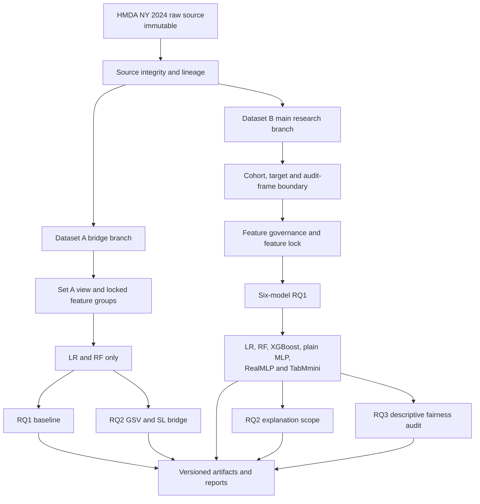

# DAP391m Group 12

Nghiên cứu dự đoán kết quả phê duyệt khoản vay thế chấp từ HMDA New York 2024. Dự án có hai nhánh nghiên cứu độc lập: Dataset A là bridge analysis cho RQ1/RQ2; Dataset B là tập thực nghiệm chính cho RQ1/RQ2/RQ3.

Mục tiêu là dự đoán xác suất hồ sơ được phê duyệt, không phải xác suất vỡ nợ, mức độ tín nhiệm thực tế, hay bằng chứng nhân quả/pháp lý về phân biệt đối xử.

## Quy tắc dữ liệu chung

- Cohort nghiên cứu chỉ giữ `action_taken ∈ {1, 2, 3}`.
- `y_approved = 1` khi `action_taken ∈ {1, 2}`; `y_approved = 0` khi `action_taken = 3`.
- `action_taken` được giữ để tạo target và truy vết, không thuộc feature matrix `X`.
- Raw source là immutable. Mỗi dataset có feature contract, split, preprocessing, model và artifact độc lập.
- Không dùng test set để chọn feature, fit preprocessing hay tune model.

## Pipeline toàn dự án



Source-lineage conventions và target rule có thể dùng chung; `X`, audit metadata, split manifests, fitted preprocessing, models, predictions và results không được dùng chung giữa Dataset A và Dataset B.

## Pipeline modes và model scope

| Mode | Dataset A | Dataset B | Model được chạy |
|---|---|---|---|
| `source_integrity` | Kiểm tra nguồn và lineage | Kiểm tra nguồn và lineage | Không chạy model |
| `dataset_view` | Tạo Set A view theo contract đã khóa | Tạo cohort, target và audit frame | Không chạy model |
| `feature_governance` | Không mở lại Set A contract | Audit, redundancy, representation và feature lock | Không chạy sáu model; LR/RF chỉ dùng cho sensitivity hẹp nếu được phê duyệt |
| `rq1_train_evaluate` | Baseline bridge | Thực nghiệm chính | A: LR, RF. B: LR, RF, XGBoost, plain MLP, RealMLP, TabMmini |
| `rq2_explain` | GSV/SL bridge | Chỉ sau RQ1 và feature lock | A: LR, RF. B: LR, RF, XGBoost và một neural model được chọn sau RQ1 |
| `rq3_fairness_audit` | Ngoài scope Set A hiện tại | Audit prediction theo `record_id` | Cả sáu model Dataset B |
| `reporting` | Baseline và explanation artifacts | RQ1, RQ2, RQ3 artifacts | Không retrain model |

## Preprocessing contract

Dataset A và Dataset B không dùng chung fitted preprocessor. Trong từng dataset, mọi model phải nhận cùng feature information đã khóa; khác biệt chỉ nằm ở preprocessing profile phù hợp model family.

```text
locked raw feature information
            │
            ▼
train-only, family-specific preprocessing profile
            │
            ▼
fitted model pipeline and versioned artifact
```

Thông số imputation, encoding, scaling, outlier handling, balancing, seed và tuning budget của Dataset B chưa được khóa đầy đủ. Vì vậy README không tự quy định algorithm preprocessing cụ thể cho sáu model. Bất kỳ profile nào cũng phải fit trên train/fold tương ứng và không được thêm hoặc loại information so với feature set đã phê duyệt.

## Cấu trúc thư mục hiện tại

```text
DAP391m_GR12/
│
├── README.md                    # Tài liệu kiến trúc, pipeline modes và phạm vi Dataset A/B
├── pyproject.toml               # Metadata package và dependency policy của dự án
├── requirements.txt             # Danh sách dependency hiện có
├── .gitignore                   # Quy tắc ignore hiện hữu; Dataset B artifacts cần được review trước khi tạo outputs
│
├── config/                      # Cấu hình hiện hữu và Dataset B contract templates
│   ├── config.yaml              # Target rule và cấu hình dataset hiện hữu
│   ├── features.yaml            # Legacy/shared feature config; cần đồng bộ sau feature lock Dataset B
│   ├── model_config.yaml        # Vị trí lưu model configuration history khi được sử dụng
│   └── dataset_b/               # Dành cho data, feature, split, model, RQ2 và RQ3 contracts versioned
│
├── data/
│   ├── raw/                     # HMDA source read-only, không ghi đè
│   ├── processed/datasetA/      # Khu vực output hiện hữu, tách riêng cho Dataset A
│   └── dataset_b/               # Namespace Dataset B: derived data, audit frame và split manifests
│
├── artifacts/dataset_b/         # Khu vực artifact Dataset B theo dataset/feature/split/model/run version
│
├── notebooks/                   # EDA và evidence notebooks; không là nguồn duy nhất của contract
│   ├── 01_eda.ipynb             # EDA tổng quát hiện hữu
│   └── eda_datasetB/            # Feature-governance notebooks của Dataset B
│
├── docs/                        # Nguồn yêu cầu kỹ thuật, planning và feature-governance evidence
├── reports/                     # Báo cáo và figures được tạo từ artifacts đã khóa
├── sql/                          # Không gian SQL của dự án
│
├── src/
│   ├── utils/                   # Utility dùng chung: project paths, config loading và logging
│   ├── pipeline/                # Legacy/general pipeline scaffold; không phải pipeline Dataset B độc lập
│   └── dataset_b/               # Namespace implementation Dataset B: preparation đến artifacts, tách khỏi Dataset A
│
└── tests/                       # Test cho utility và pipeline khi implementation được bổ sung
```

`src/api/` hiện tồn tại như scaffold nhưng không thuộc research pipeline hiện tại. API serving chỉ được xem xét sau khi một model artifact đã được đăng ký rõ; không được dùng để quyết định feature selection, RQ2 hoặc RQ3.

## Dataset A

Dataset A là bridge analysis, không phải đại diện cho toàn bộ nghiên cứu Dataset B.

- Chạy Logistic Regression và Random Forest.
- Dùng cùng information content và bảy explanation groups đã khóa.
- RQ1 đánh giá baseline; RQ2 so sánh GSV và SL trên `P(approved)`.
- Không dùng kết quả Dataset A để suy rộng cho XGBoost, plain MLP, RealMLP hoặc TabMmini.

## Dataset B

Dataset B là nhánh thực nghiệm chính.

- RQ1 chạy sáu model: Logistic Regression, Random Forest, XGBoost, plain MLP, RealMLP và TabMmini.
- Feature governance diễn ra trước RQ1. Hiện có 12 raw features ở trạng thái `keep` sau screening; đây chưa phải `FINAL_MODEL_FEATURES`.
- `property_value` là `exclude_from_main`; `construction_method` và `total_units` vẫn cần representation comparison.
- `applicant_sex`, năm race slots, `lei`, `county_code` và `applicant_age` nằm ngoài `X` để audit/truy vết.
- RQ2 chỉ chạy sau RQ1 và feature lock. RQ3 là descriptive fairness audit của prediction từ cả sáu model, không phải fairness mitigation.

## Artifact tối thiểu cần bảo tồn

Mỗi run có thể tái tạo phải bảo tồn dataset/feature/split version, record IDs, fitted preprocessing, fitted model, threshold đã khóa, prediction theo `record_id`, metric outputs và bootstrap artifacts. RQ2/RQ3 chỉ đọc artifacts đã khóa, không âm thầm retrain hoặc tái tạo split.

## Trạng thái hiện tại

- Dataset B folder namespace và `DATASET_B_DIR = data/dataset_b` đã được tạo/đồng bộ.
- Dataset B contracts trong `config/dataset_b/` hiện là templates rỗng, chưa là nguồn cấu hình vận hành.
- `src/dataset_b/` là implementation namespace đã tạo, chưa xác nhận có pipeline chạy được.
- RQ2/RQ3 settings còn mở không được tự điền trong config hoặc code.
