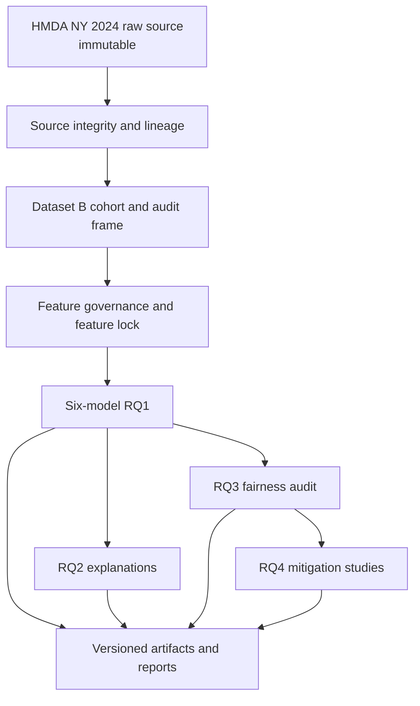

# DAP391m Group 12

Nghiên cứu dự đoán xác suất phê duyệt hồ sơ vay thế chấp từ HMDA New York
2024. Dataset B là dataset thực nghiệm duy nhất đang hoạt động trong repository.

Mục tiêu không phải dự đoán vỡ nợ hoặc mức độ tín nhiệm, và kết quả không phải
bằng chứng nhân quả hay pháp lý về phân biệt đối xử.

## Nguyên tắc dữ liệu và đánh giá

- Cohort chỉ giữ `action_taken ∈ {1, 2, 3}`.
- `y_approved = 1` khi `action_taken ∈ {1, 2}` và bằng `0` khi
  `action_taken = 3`.
- `action_taken` chỉ được dùng để tạo target và truy vết, không thuộc feature
  matrix `X`.
- Raw source là immutable.
- Không dùng Test để chọn feature, fit preprocessing, tune model hoặc chọn
  threshold.
- RQ2, RQ3 và RQ4 đọc các artifact đã khóa theo contract tương ứng; không âm
  thầm retrain, tạo lại split, threshold hoặc bootstrap.

## Luồng nghiên cứu hiện hành



Sáu model thuộc RQ1 gồm Logistic Regression, Random Forest, XGBoost, PlainMLP,
RealMLP và TabMmini. Cấu hình, preprocessing và checkpoint của từng model phải
được đọc theo contract và lineage của Dataset B.

## Điểm vào repository

```text
DAP391m_GR12/
├── config/                  # Project config và Dataset B contracts
├── data/
│   ├── raw/                 # HMDA source read-only
│   └── dataset_b/           # Dataset B derived data và split manifests
├── artifacts/dataset_b/     # Frozen/working evidence; không tự ý sửa
├── notebooks/dataset_b/     # Notebook evidence của Dataset B
├── src/dataset_b/           # Dataset B implementation
├── src/utils/               # Project path, config và logging helpers
├── docs/handbook/           # Contract, runbook và trạng thái thực nghiệm
├── reports/                 # Báo cáo tạo từ evidence đã khóa
└── tests/                   # Unit, contract và integration tests
```

[Dataset B Handbook](docs/handbook/README.md) là router authoritative cho data
contract, feature governance, preprocessing, training, evaluation và các
research question. [STATUS](docs/handbook/STATUS.md) là nguồn duy nhất cho trạng
thái thực nghiệm và accepted runs.

[Reproducibility Guide](REPRODUCE.md) cung cấp cấu trúc Mục 0–12, còn
[Reproducibility Documentation Acceptance](docs/handbook/REPRODUCIBILITY_ACCEPTANCE.md)
là register nghiệm thu tài liệu. Register này không thay thế STATUS và không
tuyên bố clean install, training, model inference/evaluation hoặc GPU execution
đã được chạy lại.
