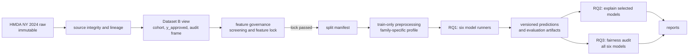

# Dataset B — Execution Pipeline

## 1. Mục đích và trạng thái

Tài liệu này mô tả luồng thực thi Dataset B sau khi data contract và feature-governance được chấp thuận. Nó không thay thế:

- [Data Selection](Dataset_B_Data_Selection.md): cohort, target, 99-column roles, exclusions và audit metadata;
- [Feature Selection](Feature_selection.md): screening evidence, feature decisions và feature-lock gate;
- repository [README](../README.md): kiến trúc chung Dataset A + Dataset B.

**Trạng thái hiện tại (22/09/2026):** split và preprocessing CV pha 1 đã có code cùng dữ liệu xuất v2 gồm 66 cột; chưa chạy LR/RF/XGBoost, chưa có fitted model hoặc kết quả RQ1. [Quyết định preprocessing và baseline pha 1](Dataset_B_v1_preprocessing.md) ghi rõ phần đã triển khai. `config/dataset_b/feature_set_v1.yaml` và `config/dataset_b/model_protocol_v1.yaml` đã được đồng bộ với `dataset_b_preprocessing_v2` và ba baseline cố định.

## 2. Luồng Dataset B độc lập

Dataset B không dùng chung `X`, audit metadata, split manifest, fitted preprocessor, model, prediction hay result với Dataset A. Raw source không bị ghi đè; `action_taken` chỉ dùng tạo target/truy vết, không thuộc `X`.

## 3. Execution modes

| Mode | Mục tiêu | Model scope | Điều kiện vào | Output tối thiểu |
| --- | --- | --- | --- | --- |
| `source_integrity` | Xác nhận source, schema, lineage | Không chạy model | Raw source có thể đọc | Source identity và schema check |
| `dataset_view` | Tạo cohort, `y_approved`, `record_id` và audit frame | Không chạy model | Source integrity pass | Dataset/view version và audit columns ngoài `X` |
| `feature_governance` | Audit, redundancy, representation và feature decision | Không chạy sáu model; LR/RF sensitivity chỉ khi được phê duyệt | Dataset view đã khóa | Feature registry, decision table, explanation groups khi đã khóa |
| `rq1_train_evaluate` | Huấn luyện và đánh giá thực nghiệm chính | LR, RF, XGBoost, plain MLP, RealMLP, TabMmini | Temporary training feature lock và split manifest | Fitted pipelines/models, predictions và evaluation artifacts |
| `rq2_explain` | GSV/SL trên artifact đã khóa | LR, RF, XGBoost và một neural model được chọn sau RQ1 | RQ1 hoàn tất, feature lock | Explanation artifacts theo business player |
| `rq3_fairness_audit` | Audit prediction theo nhóm | Cả sáu model Dataset B | RQ1 predictions theo `record_id` | Fairness-audit artifacts và denominators |
| `reporting` | Đọc artifact đã khóa để báo cáo | Không retrain | Artifact tương ứng tồn tại | Report/figure có version nguồn |

RQ2 và RQ3 không được âm thầm retrain model hoặc tái tạo split. GSV/SL và fairness settings còn mở phải được chốt riêng trước khi thực thi.

## 4. Preprocessing contract và model routes

Mọi model nhận cùng **locked raw feature information**. Mỗi family có thể dùng profile preprocessing khác, nhưng profile không được thêm/bỏ business information hoặc fit trên validation/test.

| Model | Family route | Preprocessing requirement hiện đã chốt | Còn phải triển khai hoặc chốt |
| --- | --- | --- | --- |
| Logistic Regression | Linear | Two-channel, OHE bỏ dummy `OBSERVED` và `RobustScaler` cho bốn kênh số; baseline không trọng số lớp | Model runner chưa triển khai |
| Random Forest | Tree | Two-channel, OHE bỏ dummy `OBSERVED`, không scale; baseline không trọng số lớp | Model runner chưa triển khai |
| XGBoost | Tree boosting | Two-channel, OHE bỏ dummy `OBSERVED`, không scale; baseline không trọng số lớp | Model runner chưa triển khai |
| plain MLP | Neural | Train-only profile trên locked information | Imputation, encoding, scaling, balancing, tuning |
| RealMLP | Neural tabular | Train-only profile trên locked information | Profile implementation và mọi hyperparameter |
| TabMmini | Neural tabular | Train-only profile trên locked information | Profile implementation và mọi hyperparameter |

Các ràng buộc bắt buộc cho mọi route:

- fit mọi transformation trên train hoặc train fold tương ứng;
- với profile pha 1, đưa blank/whitespace và `NaN` thực vào `MISSING`; giữ `NA`, `Exempt`/`1111` và not-applicable theo đúng miền của từng cột;
- không tự xóa/clip/log-transform outlier chỉ từ diagnostics;
- không đưa `lei`, `county_code`, `applicant_sex`, `applicant_age` hay năm applicant-race slots vào main `X`;
- không dùng test set cho feature decision, preprocessing fit hoặc tuning.

### 4.1. Neural wrapper contract đã chốt

Plain MLP, RealMLP và TabMmini phải đi qua **một wrapper contract chung tương thích scikit-learn**. Wrapper là tầng giao tiếp thống nhất với orchestration/CV; nó không buộc ba model dùng chung preprocessing hoặc cùng backend implementation.

Wrapper phải đáp ứng các điều kiện sau:

- tương thích `BaseEstimator` và `ClassifierMixin`, hỗ trợ tối thiểu `fit`, `predict_proba`, `get_params`, `set_params` và clone trong cross-validation;
- công bố `classes_` theo thứ tự `[0, 1]`; cột `predict_proba(X)[:, 1]` luôn là `P(y_approved = 1)`;
- quản lý hoặc ủy quyền nhất quán việc chuyển dữ liệu sang tensor, random seed, device, batch/DataLoader và fitted state của backend;
- khởi tạo fitted state độc lập cho từng fold; không tái sử dụng model, optimizer hoặc fitted transformer từ fold khác;
- không tự tạo hoặc thay đổi split, không tự đọc validation/test và không tự retrain khi gọi `predict_proba`;
- cho phép lưu và truy vết preprocessing version, model configuration, random state và fitted-state artifact của từng run.

Ranh giới fit/transform bắt buộc cho cả transformer nằm ngoài wrapper và transformer nội bộ của backend:

1. Trong mỗi fold của 5-fold CV trên Train 70%, mọi transformer và neural backend chỉ được `fit` trên fold-train; fold-validation chỉ được `transform` và dự báo.
2. Sau khi chọn configuration, preprocessing và model được khởi tạo lại rồi `fit` trên toàn bộ Train 70%.
3. Validation 15% chỉ được `transform` và dự báo để chọn threshold bằng Balanced Accuracy; không được `fit`, `partial_fit`, cập nhật vocabulary hoặc tính lại thống kê preprocessing.
4. Sau khi threshold đã khóa, Test 15% chỉ được `transform` và dự báo cho final evaluation; không được dùng để thay đổi preprocessing, model, configuration hoặc threshold.

Contract wrapper này đã khóa kiến trúc giao tiếp và leakage boundary. Quyết định pha 1 cho LR/RF/XGBoost nằm tại [tài liệu preprocessing](Dataset_B_v1_preprocessing.md#7-baseline-model-pha-1-đã-chốt-để-triển-khai-tiếp); profile cho ba neural family còn phải chốt riêng.

## 5. Decision register v0.2 — RQ1

Các quyết định dưới đây áp dụng sau data contract. Register tách riêng temporary training feature lock, các quyết định RQ1 đã chốt và các mục vẫn chờ chốt; không suy diễn thêm giá trị cho các mục cuối.

### 5.1. Temporary training feature lock

RQ1/CV dùng **temporary training feature lock v0.2** do [Feature Selection](Feature_selection.md#13-trạng-thái-quyết-định-hiện-tại) quản lý. Đây là nguồn duy nhất cho danh sách 12 feature, các exclusion/representation decision và ranh giới với `FINAL_MODEL_FEATURES`.

Pipeline chỉ yêu cầu feature version này được lưu cùng split, preprocessing, model và prediction artifact; không tự thêm candidate hoặc representation còn mở.

### 5.2. Split, CV và final configuration

| Hạng mục | Quyết định hiện hành | Ranh giới |
| --- | --- | --- |
| Train / validation / test split | `70% / 15% / 15%` | Tạo split manifest cố định theo record level. |
| Random state | `42` | Áp dụng cho split manifest và CV splitter đã chốt. |
| LEI grouping constraint | Không dùng | `lei` không thuộc 12 core features và hiện không là grouping constraint. |
| CV | Bắt buộc: `StratifiedKFold`, `k = 5`, `shuffle = True`, `random_state = 42` | Chỉ chạy trên Train 70%; validation và test không xuất hiện trong bất kỳ fold nào. |
| Chọn configuration | Mean ROC-AUC là primary; standard deviation ROC-AUC là stability evidence | Baseline pha 1 có đúng một configuration cố định cho mỗi family, nên CV đo hiệu năng/độ ổn định chứ không tìm hyperparameter. Nếu mở tuning về sau, chỉ chọn trong Train CV. |
| Refit | Refitting trên toàn Train 70% | Chỉ thực hiện sau khi configuration của model family đã được chọn. |
| Validation set | 15%, độc lập khỏi CV | Chọn threshold riêng cho mỗi model bằng tối đa hóa Balanced Accuracy; sau đó khóa threshold. Validation cũng giữ artifact cần thiết cho downstream RQ. |
| Test set | 15%, độc lập khỏi CV | Chỉ dùng cho final RQ1 evaluation sau khi configuration, preprocessing và threshold đã khóa. |

### 5.3. RQ1 metric và uncertainty contract đã chốt

Metric contract RQ1, bootstrap và uncertainty được quản lý duy nhất tại [Project Planning Recover](Project_planning_recover.docx) và [Set B Technical Requirement](<Yêu cầu Kỹ thuật Set B cho RQ1 và RQ2 và RQ3 - HMDA NY 2024 - Revised.docx>). Pipeline chỉ áp dụng các execution boundary đã nêu ở Section 5.2: configuration được khóa sau CV, threshold được khóa trên validation, và test chỉ dùng cho final RQ1 evaluation.

### 5.4. Mục chờ chốt — không tự điền

| Hạng mục | Trạng thái |
| --- | --- |
| Search procedure và trial budget | Pha 1 LR/RF/XGBoost dùng một baseline cố định cho mỗi model, trial budget bằng 1 và không search; quy tắc cho pha tuning hoặc neural còn chờ chốt. |
| Early stopping | Pha 1 LR/RF/XGBoost không dùng early stopping hoặc `eval_set`; thiết lập cho neural còn chờ chốt. |
| Preprocessing theo model family | Pha 1 theo [quyết định preprocessing](Dataset_B_v1_preprocessing.md): 66 cột, bỏ bốn dummy `OBSERVED`, LR scale bốn kênh số, RF/XGBoost không scale. Profile neural còn mở; wrapper và fit/transform boundary đã chốt tại Section 4.1. |
| CI cho chênh lệch metric giữa các model | Chờ chốt: phương pháp và quy tắc tuyên bố ý nghĩa thống kê. |
| Cấu trúc percentile / chi tiết CI RQ1 còn lại | Chờ chốt nếu chưa được xác định riêng cho Dataset B. |
| RQ2 và RQ3 settings | Chờ chốt riêng; không tự suy diễn explanation sample, background, compute budget, Top-k hoặc fairness threshold. |

## 6. Gate và artifact handoff

| Gate | Pass condition | Handoff được phép | Không được phép |
| --- | --- | --- | --- |
| Data contract | Cohort/target, 99-column roles và audit boundary được đối soát | Dataset B view | Fit model hoặc biến audit metadata thành predictor |
| Temporary training feature lock | Feature version tham chiếu [Feature Selection](Feature_selection.md#13-trạng-thái-quyết-định-hiện-tại) được ghi trong artifact RQ1 | Split, CV và RQ1 theo temporary feature version | Gọi temporary lock là `FINAL_MODEL_FEATURES` hoặc tự thêm candidate/representation còn mở |
| Final feature lock | Open representation/candidate decisions đã được giải quyết và `FINAL_MODEL_FEATURES`/`EXPLANATION_GROUPS` được version | RQ1 version cuối và các deliverable kết luận cuối | Tuyên bố temporary lock là final lock khi điều kiện còn mở |
| RQ1 artifact | Split, preprocessing, model, prediction và evaluation artifacts đã khóa | RQ2/RQ3 đọc artifact | RQ2/RQ3 retrain hoặc đổi feature/split |
| RQ2/RQ3 protocol | Settings riêng được phê duyệt | Explainability/fairness run | Tự đặt coalition semantics, sample/budget, Top-k hay fairness threshold |

Mỗi run có thể tái tạo cần liên kết ít nhất dataset/view version, feature version, split version, preprocessing version, model/run version và `record_id` của predictions. Artifact policy chi tiết sẽ được triển khai cùng module/code tương ứng, không được giả định là đã tồn tại.

## 7. Mapping sang cấu trúc mã

`src/pipeline/` là legacy/general scaffold, không phải Dataset B pipeline độc lập. Namespace `src/dataset_b/` là đích triển khai tách biệt:

| Namespace | Trách nhiệm dự kiến |
| --- | --- |
| `preparation/` | Source checks, cohort, target và audit frame |
| `features/` | Feature registry, decision/version handoff |
| `splits/` | Split manifest và reproducibility boundary |
| `preprocessing/` | Train-only, family-specific profiles |
| `models/` | Sáu RQ1 model runners |
| `evaluation/` | RQ1 metrics, predictions và calibration artifacts khi được chốt |
| `explainability/` | RQ2 orchestration sau RQ1 |
| `fairness/` | RQ3 descriptive audit sau RQ1 |
| `artifacts/` | Versioned run/artifact registry |

Các tên trên là architecture mapping, không xác nhận mọi module đã tồn tại hoặc runnable. Hiện `splits/` và phần preprocessing pha 1 đã có code; model runner và các bước đánh giá RQ1 chưa có bằng chứng chạy.

## 8. Đọc theo nhiệm vụ

- Cần thay đổi cohort, column role hoặc audit boundary: đọc Data Selection trước.
- Cần thêm/bỏ feature hoặc thay representation: đọc Feature Selection trước.
- Cần quyết định route thực thi/model/preprocessing: đọc tài liệu này, sau đó mở scope riêng cho config hoặc code.
- Cần kiến trúc tổng Dataset A + B: đọc repository README.
