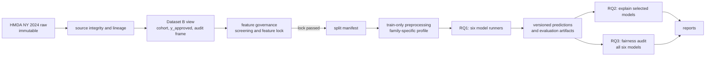

# Dataset B — Execution Pipeline

## 1. Mục đích và trạng thái

Tài liệu này mô tả luồng thực thi Dataset B sau khi data contract và feature-governance được chấp thuận. Nó không thay thế:

- [Data Selection](Dataset_B_Data_Selection.md): cohort, target, 99-column roles, exclusions và audit metadata;
- [Feature Selection](Feature_selection.md): screening evidence, feature decisions và feature-lock gate;
- repository [README](../README.md): kiến trúc chung Dataset A + Dataset B.

**Trạng thái hiện tại:** đây là execution design, không phải bằng chứng pipeline đã chạy. `src/dataset_b/` mới có skeleton thư mục; `config/dataset_b/` có các template contract nhưng README xác định chúng chưa là cấu hình vận hành. Không suy ra imputation, encoding, scaling, balancing, seed, tuning budget hay GSV/SL settings khi các giá trị đó chưa được khóa.

## 2. Luồng Dataset B độc lập

Dataset B không dùng chung `X`, audit metadata, split manifest, fitted preprocessor, model, prediction hay result với Dataset A. Raw source không bị ghi đè; `action_taken` chỉ dùng tạo target/truy vết, không thuộc `X`.

## 3. Execution modes

| Mode | Mục tiêu | Model scope | Điều kiện vào | Output tối thiểu |
| --- | --- | --- | --- | --- |
| `source_integrity` | Xác nhận source, schema, lineage | Không chạy model | Raw source có thể đọc | Source identity và schema check |
| `dataset_view` | Tạo cohort, `y_approved`, `record_id` và audit frame | Không chạy model | Source integrity pass | Dataset/view version và audit columns ngoài `X` |
| `feature_governance` | Audit, redundancy, representation và feature decision | Không chạy sáu model; LR/RF sensitivity chỉ khi được phê duyệt | Dataset view đã khóa | Feature registry, decision table, explanation groups khi đã khóa |
| `rq1_train_evaluate` | Huấn luyện và đánh giá thực nghiệm chính | LR, RF, XGBoost, plain MLP, RealMLP, TabMmini | Feature lock và split manifest | Fitted pipelines/models, predictions và evaluation artifacts |
| `rq2_explain` | GSV/SL trên artifact đã khóa | LR, RF, XGBoost và một neural model được chọn sau RQ1 | RQ1 hoàn tất, feature lock | Explanation artifacts theo business player |
| `rq3_fairness_audit` | Audit prediction theo nhóm | Cả sáu model Dataset B | RQ1 predictions theo `record_id` | Fairness-audit artifacts và denominators |
| `reporting` | Đọc artifact đã khóa để báo cáo | Không retrain | Artifact tương ứng tồn tại | Report/figure có version nguồn |

RQ2 và RQ3 không được âm thầm retrain model hoặc tái tạo split. GSV/SL và fairness settings còn mở phải được chốt riêng trước khi thực thi.

## 4. Preprocessing contract và model routes

Mọi model nhận cùng **locked raw feature information**. Mỗi family có thể dùng profile preprocessing khác, nhưng profile không được thêm/bỏ business information hoặc fit trên validation/test.

| Model | Family route | Preprocessing requirement hiện đã chốt | Chi tiết chưa được chốt |
| --- | --- | --- | --- |
| Logistic Regression | Linear | Train-only profile trên locked information | Imputation, encoding, scaling, balancing, tuning |
| Random Forest | Tree | Train-only profile trên locked information | Imputation, encoding, balancing, tuning |
| XGBoost | Tree boosting | Train-only profile trên locked information | Imputation, encoding, balancing, tuning |
| plain MLP | Neural | Train-only profile trên locked information | Imputation, encoding, scaling, balancing, tuning |
| RealMLP | Neural tabular | Train-only profile trên locked information | Profile implementation và mọi hyperparameter |
| TabMmini | Neural tabular | Train-only profile trên locked information | Profile implementation và mọi hyperparameter |

Các ràng buộc bắt buộc cho mọi route:

- fit mọi transformation trên train hoặc train fold tương ứng;
- giữ blank, `NA`, `Exempt`/`1111` và not-applicable tách biệt cho đến khi profile đã được phê duyệt;
- không tự xóa/clip/log-transform outlier chỉ từ diagnostics;
- không đưa `lei`, `county_code`, `applicant_sex`, `applicant_age` hay năm applicant-race slots vào main `X`;
- không dùng test set cho feature decision, preprocessing fit hoặc tuning.

## 5. Gate và artifact handoff

| Gate | Pass condition | Handoff được phép | Không được phép |
| --- | --- | --- | --- |
| Data contract | Cohort/target, 99-column roles và audit boundary được đối soát | Dataset B view | Fit model hoặc biến audit metadata thành predictor |
| Feature lock | Open representation/candidate decisions đã được giải quyết và `FINAL_MODEL_FEATURES`/`EXPLANATION_GROUPS` được version | Split và RQ1 | Tuyên bố 12 `keep` là final lock khi điều kiện còn mở |
| RQ1 artifact | Split, preprocessing, model, prediction và evaluation artifacts đã khóa | RQ2/RQ3 đọc artifact | RQ2/RQ3 retrain hoặc đổi feature/split |
| RQ2/RQ3 protocol | Settings riêng được phê duyệt | Explainability/fairness run | Tự đặt coalition semantics, sample/budget, Top-k hay fairness threshold |

Mỗi run có thể tái tạo cần liên kết ít nhất dataset/view version, feature version, split version, preprocessing version, model/run version và `record_id` của predictions. Artifact policy chi tiết sẽ được triển khai cùng module/code tương ứng, không được giả định là đã tồn tại.

## 6. Mapping sang cấu trúc mã

`src/pipeline/` là legacy/general scaffold, không phải Dataset B pipeline độc lập. Namespace `src/dataset_b/` là đích triển khai tách biệt:

| Namespace | Trách nhiệm dự kiến |
| --- | --- |
| `preparation/` | Source checks, cohort, target và audit frame |
| `features/` | Feature registry, decision/version handoff |
| `splits/` | Split manifest và reproducibility boundary |
| `preprocessing/` | Train-only, family-specific profiles |
| `models/` | Sáu RQ1 model runners |
| `evaluation/` | RQ1 metrics, predictions và calibration artifacts khi được chốt |
| `explainability/` | RQ2 orchestration sau RQ1 |
| `fairness/` | RQ3 descriptive audit sau RQ1 |
| `artifacts/` | Versioned run/artifact registry |

Các tên trên là architecture mapping cho skeleton hiện có, không phải xác nhận module implementation đã tồn tại hoặc runnable.

## 7. Đọc theo nhiệm vụ

- Cần thay đổi cohort, column role hoặc audit boundary: đọc Data Selection trước.
- Cần thêm/bỏ feature hoặc thay representation: đọc Feature Selection trước.
- Cần quyết định route thực thi/model/preprocessing: đọc tài liệu này, sau đó mở scope riêng cho config hoặc code.
- Cần kiến trúc tổng Dataset A + B: đọc repository README.
